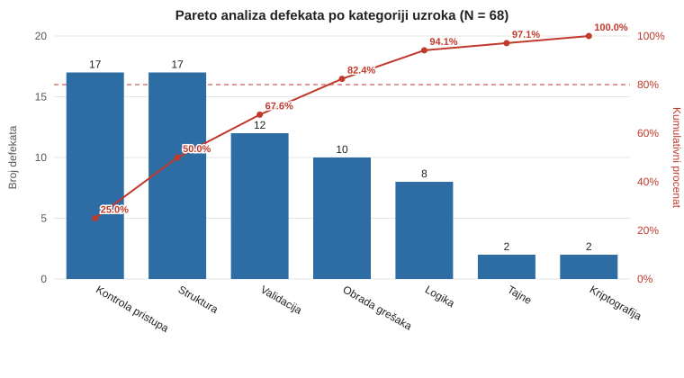

# Izvještaj o inspekciji koda

Grupa 3 – Tim 2, Verifikacija i validacija softvera, Projektni zadatak I dio (Task 1.1)

Kod koji smo pregledali je aplikacija Cvjećara Latica (Grupa 3 – Tim 3). Kod se nalazi na grani `inspekcija`, a inspekcija je rađena kroz pull request #1 (`inspekcija` → `main`).

## 1. Način rada

Za svaki pronađeni defekt ostavljen je komentar na liniji koda u pull requestu. Za nalaze ozbiljnosti 3, 4 i 5 otvorena je i issue kartica, sa labelama za ozbiljnost, listu provjere i kategoriju uzroka.

Kod smo pregledali u dva prolaza:

- Lista A – opšta lista provjere iz Predavanja 2 (Wiegers): struktura, dokumentacija, varijable, aritmetika, petlje i grananja, defanzivno programiranje
- Lista B – sigurnosna lista provjere iz Predavanja 3: validacija unosa, tajni podaci, autorizacija, kriptografija, greške i logiranje, vanjske biblioteke. Uz sigurnosne nalaze naveli smo CWE oznaku i kategoriju iz OWASP Top 10 (2025).

Za ozbiljnost smo koristili skalu iz Predavanja 2: 5 – Kritično, 4 – Visoko, 3 – Srednje, 2 – Nisko, 1 – Minorno.

Moderator inspekcije je bila Nejla Hopić. Ona je podijelila fajlove i liste provjere članovima tima i pregledala nalaze. Fajlovi su podijeljeni ovako:

| Član tima | Uloga | Pregledani fajlovi |
|---|---|---|
| Nejla Hopić | Moderator, inspektor | CartsController.cs, OrdersController.cs, ProductOrdersController.cs, ProductsController.cs, ApplicationDbContext.cs, EmailService.cs, UnclaimedOrderChecker.cs |
| Lejla Gičević | Inspektor | DiscountsController.cs, PaymentsController.cs, HomeController.cs, ProductSalesController.cs, ReportsController.cs, appsettings.json, Models/ |
| Lamija Maglić | Inspektor | Views/, Program.cs, Cvjecara_Latica.csproj i ostali konfiguracijski fajlovi |

## 2. Rezultati

| Fajlovi | Defekata | 5 | 4 | 3 | 2 | 1 |
|---|---:|---:|---:|---:|---:|---:|
| CartsController.cs | 14 | 2 | 5 | 7 | – | – |
| DiscountsController.cs | 7 | – | – | 2 | 2 | 3 |
| OrdersController.cs | 6 | 1 | – | 3 | 1 | 1 |
| PaymentsController.cs | 2 | – | 2 | – | – | – |
| HomeController.cs | 3 | – | 1 | 2 | – | – |
| ProductSalesController.cs, ReportsController.cs | 3 | – | 1 | – | 2 | – |
| appsettings.json | 1 | 1 | – | – | – | – |
| Models/ | 5 | – | 3 | 1 | 1 | – |
| ProductOrdersController.cs | 3 | – | 1 | 2 | – | – |
| ProductsController.cs | 2 | – | – | 2 | – | – |
| ApplicationDbContext.cs, EmailService.cs, UnclaimedOrderChecker.cs | 5 | – | 1 | 4 | – | – |
| Views/, Program.cs, .csproj | 17 | – | 1 | 4 | 7 | 5 |
| Ukupno | 68 | 4 | 15 | 27 | 13 | 9 |

Ukupno je pronađeno 68 defekata. Od toga je 19 kritične ili visoke ozbiljnosti.

Najozbiljniji nalazi su:

| Ozbiljnost | Nalaz | Gdje |
|---|---|---|
| 5 | Iznos za plaćanje se šalje iz forme (hidden polje), pa ga korisnik može promijeniti | CartsController.cs:338, ConfirmOrder.cshtml:44 |
| 5 | Broj kartice se sprema u bazu kao običan tekst | CartsController.cs:381 |
| 5 | Detalji narudžbe imaju `[AllowAnonymous]`, pa svako može vidjeti tuđe narudžbe | OrdersController.cs:47–58 |
| 5 | Lozinke za email i bazu su u `appsettings.json` na GitHubu | appsettings.json:3, 19 |
| 4 | Korisnik može ocijeniti tuđu narudžbu promjenom `orderId` (IDOR) | CartsController.cs:447–453 |
| 4 | Pogrešne zagrade u uslovu, pa administrator mijenja pogrešnu korpu | CartsController.cs:122–123 |
| 4 | Zbog non-nullable svojstava u modelima ne rade Create i Edit u više kontrolera | ProductOrder.cs, Discount.cs, Product.cs |
| 4 | Polje za promo kod se ne prikazuje jer input za telefon nije zatvoren | PlaceOrder.cshtml:38–46 |

## 3. Pareto analiza

Svaki defekt smo svrstali u jednu kategoriju uzroka. Kategorije su iste kao labele na issue karticama. U tabeli su poredane od najveće prema najmanjoj, sa kumulativnim procentom.

| Kategorija | Broj | Udio | Kumulativno | Ozbiljnost 4–5 |
|---|---:|---:|---:|---:|
| Kontrola pristupa | 17 | 25,0% | 25,0% | 7 |
| Struktura | 17 | 25,0% | 50,0% | 0 |
| Validacija | 12 | 17,6% | 67,6% | 2 |
| Obrada grešaka | 10 | 14,7% | 82,4% | 1 |
| Logika | 8 | 11,8% | 94,1% | 6 |
| Tajne | 2 | 2,9% | 97,1% | 1 |
| Kriptografija | 2 | 2,9% | 100,0% | 2 |
| Ukupno | 68 | | | 19 |

Prve četiri kategorije (kontrola pristupa, struktura, validacija i obrada grešaka) čine 82% svih defekata, tako da se većina problema nalazi u ovim oblastima.

Kontrola pristupa je najbitnija kategorija jer ima najviše defekata i najviše ozbiljnih nalaza (7 od 19). Problem se ponavlja kroz cijelu aplikaciju jer se prava pristupa postavljaju ručno na pojedinačnim akcijama. Tako `[AllowAnonymous]` poništi `[Authorize]` sa klase, nigdje se ne provjerava da li zapis pripada prijavljenom korisniku, a CSRF zaštita nije uključena globalno u `Program.cs`.

Struktura ima isto 17 defekata, ali nijedan nije ozbiljnosti 4 ili 5. To su uglavnom zakomentarisan kod, ponovljeni dijelovi koda i paketi koji se ne koriste. Ovakve greške dobro pronalazi i alat za statičku analizu (Task 1.2).

Kod validacije je problem sličan kao kod kontrole pristupa. Server prihvata vrijednosti koje dolaze od korisnika (iznos, količina, cijena, ID) i provjerava samo `ModelState.IsValid`, bez provjere poslovnih pravila.

Logika ima samo 8 defekata, ali je 6 od njih visoke ozbiljnosti, jer zbog njih ne rade neke funkcionalnosti (dodavanje proizvoda i popusta, deaktivacija naloga, unos promo koda).

Ako se posmatraju samo nalazi ozbiljnosti 4 i 5, kontrola pristupa i logika zajedno imaju 13 od 19 takvih nalaza.

## 4. Zaključak

Pregledan je cijeli kod aplikacije: kontroleri, modeli, servisi, pogledi i konfiguracija. Najviše problema ima u dijelu za kupovinu i plaćanje. Iznos dolazi od korisnika, broj kartice nije šifrovan, a narudžbe se mogu vidjeti bez prijave. Timu koji je pisao aplikaciju preporučujemo da prvo uključe globalnu CSRF zaštitu i autorizaciju na nivou kontrolera, da iznose računaju na serveru, da uklone lozinke iz repozitorija i da ažuriraju biblioteke koje imaju poznate ranjivosti.

Svi nalazi su detaljno opisani u komentarima na pull requestu #1 i u issue karticama.
